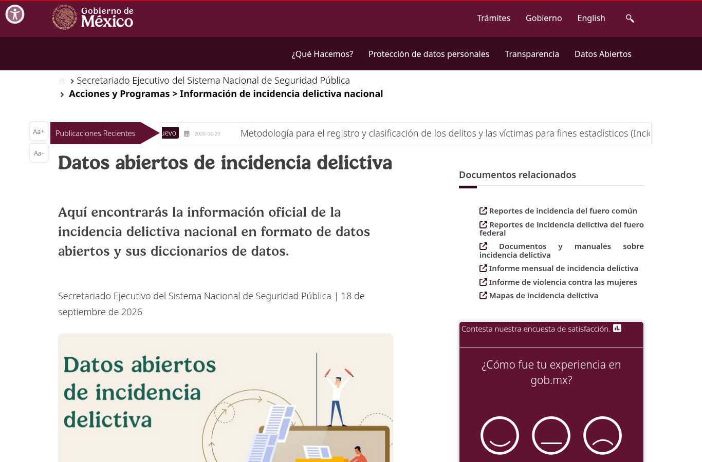

Cifras oficiales de carpetas de investigación (delitos) y de víctimas, por entidad y mes. Es la fuente principal de violencia de género del proyecto.

| Campo | Descripción |
|---|---|
| **Nombre y dueño** | Incidencia delictiva del fuero común — Delitos y Víctimas. Secretariado Ejecutivo del Sistema Nacional de Seguridad Pública, órgano del Gobierno de México que concentra las cifras de las fiscalías estatales. |
| **URL** | <https://www.gob.mx/sesnsp/acciones-y-programas/datos-abiertos-de-incidencia-delictiva> |
| **Acceso** | Descarga directa de dos ZIP (*2015–2025, Fuero común, Delitos/Víctimas, estatal*). Corte: agosto 2026. |
| **Formato y tamaño** | CSV latin-1. Delitos: 4.6 MB, 34,496 filas, 19 columnas. Víctimas: 12.4 MB, 80,960 filas, 21 columnas. |
| **Grano** | Delitos: una fila por entidad, año, tipo, subtipo y modalidad, con 12 columnas mensuales. Víctimas: además sexo y rango de edad. |
| **Cobertura** | Enero 2015 – diciembre 2025, mensual; actualización mensual. |
| **Información de México** | 32 entidades. Incluye feminicidio, violencia familiar, violación, abuso, acoso y hostigamiento sexual, y "violencia de género en todas sus modalidades distinta a la violencia familiar". |
| **Licencia y restricciones** | Datos abiertos del Gobierno de México. Datos agregados, sin información personal. |
| **Llaves de integración** | `Clave_Ent`: número de entidad del INEGI (1 = Aguascalientes … 32 = Zacatecas); se une con `CVE_ENT` de ENDIREH y `CVE_GEO` de CONAPO. `Año` + columna del mes: forman la fecha mensual que se une con los charts musicales agregados por mes. `Tipo de delito`: se traduce a un tipo de violencia de la LGAMVLV para compararlo con ENDIREH y con las etiquetas de la música. |
| **Preguntas de E0** | P2, P3, P4. |

{width=55% fig-align="center"}

{width=100% fig-align="center"}

{width=100% fig-align="center"}

## Problemas anticipados para la integración

- **Tres metodologías.** La página de descarga del SESNSP separa los archivos en tres bloques "correspondientes a recopilaciones metodológicas utilizadas en cada uno de los periodos": 1997–2017, 2015–2025 y 2026 a la fecha. La serie 1997–2017 usa un catálogo de delitos anterior al de 2015–2025. Para 2026 en adelante (RNID), la *Nota metodológica: comparación histórica* del SESNSP [[2]](../referencias.qmd) indica que la serie se diseñó para ser comparable, pero con cambios que afectan a este proyecto: (a) *Feminicidio* ahora especifica que incluye transfeminicidios y la *Tentativa de feminicidio* aparece como subtipo nuevo; (b) aparece el delito *Violación a la intimidad sexual*, que antes se registraba en "Otros delitos contra la libertad y la seguridad sexual" o en "Violencia de género distinta a la familiar".
- **Formato ancho y codificación:** los meses vienen como columnas y el archivo está en latin-1, a diferencia de otras fuentes en UTF-8.
- **Sexo de la víctima incompleto:** el archivo de víctimas solo cubre 13 tipos de delito (homicidio, feminicidio, lesiones, secuestro, trata, entre otros). Violencia familiar y los delitos sexuales solo están en el archivo de delitos, sin sexo de la víctima.
- **Taxonomía distinta:** clasifica delitos, no los tipos de violencia de la LGAMVLV ([marco de referencia](../fuentes.qmd#marco)).

[← Volver a fuentes de datos](../fuentes.qmd)
