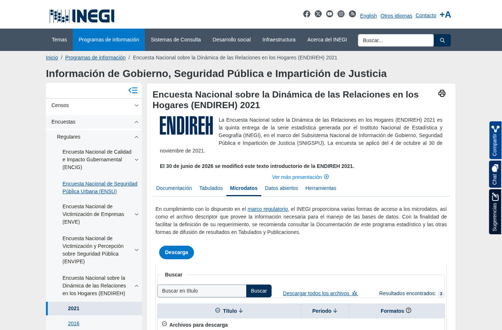

Encuesta a mujeres de 15 años y más sobre violencia psicológica, física, sexual, económica y patrimonial; sus tipos coinciden con los del artículo 6 de la LGAMVLV.

| Campo | Descripción |
|---|---|
| **Nombre y dueño** | Encuesta Nacional sobre la Dinámica de las Relaciones en los Hogares. Instituto Nacional de Estadística y Geografía, organismo autónomo responsable de la estadística oficial de México. |
| **URL** | <https://www.inegi.org.mx/programas/endireh/> (una página por edición, pestaña *Microdatos*). |
| **Acceso** | Descarga directa de un ZIP por edición. |
| **Formato y tamaño** | CSV latin-1, una tabla por sección del cuestionario. ZIP: 2003 9.3 MB; 2006 25.0 MB; 2011 28.2 MB; 2016 100.8 MB; 2021 78.9 MB. |
| **Grano** | Una fila por mujer entrevistada (o por integrante del hogar en tablas sociodemográficas); se expande con el factor de la mujer. |
| **Cobertura** | 5 levantamientos, de 2003 a 2021; sin serie mensual. |
| **Información de México** | Las 5 ediciones traen `CVE_ENT` con las 32 entidades (y municipio). 2021: 110,127 mujeres en `TB_SEC_IV`; 2016: 111,256. |
| **Licencia y restricciones** | Términos de libre uso del INEGI. Microdatos anonimizados; no representativa a nivel municipal. |
| **Llaves de integración** | `CVE_ENT`: clave INEGI de la entidad, se une con `Clave_Ent` del SESNSP y `CVE_GEO` de CONAPO. Año de levantamiento: se une con el año de las demás fuentes. Tipo de violencia (psicológica, física, sexual, económica, patrimonial): coincide directamente con la LGAMVLV y sirve de puente con SESNSP y con las etiquetas de la música. |
| **Preguntas de E0** | P2, P3, P4. |

::: {layout-ncol=2}

:::

{width=100% fig-align="center"}

## Problemas anticipados para la integración

- **Comparabilidad entre ediciones:** en la página de la edición 2011 el INEGI advierte que, por cambios metodológicos y conceptuales, "no existe una comparabilidad" con 2006 [[3]](../referencias.qmd). Tablas e identificadores cambian en cada edición (`LLAVE`, `N_CON`, `CONTROL`, `ID_VIV`/`ID_PER`) y hasta 2011 el cuestionario se separa por situación conyugal.
- **No es serie de tiempo:** solo 2021 cae en la ventana 2017–2025. Los periodos de referencia (últimos 12 meses / a lo largo de la vida) difieren de los del SESNSP.
- **Formato de la clave:** `CVE_ENT` viene como texto `"01"`; en SESNSP y CONAPO es entero `1`.
- **Muestra, no conteo:** cada mujer representa a otras según su factor de expansión.

[← Volver a fuentes de datos](../fuentes.qmd)
