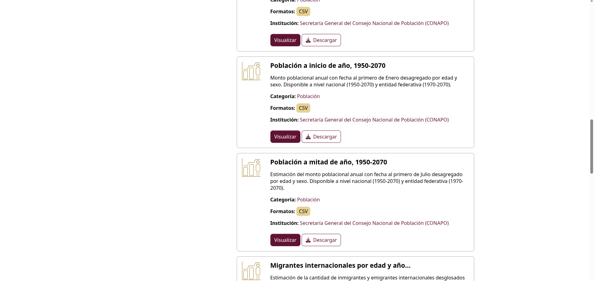
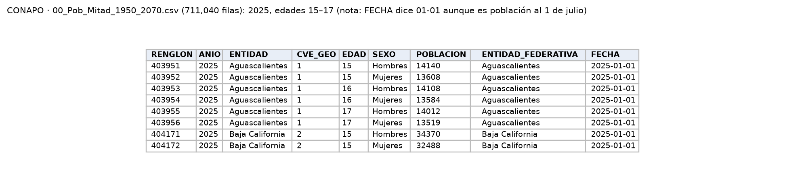

Población por entidad, edad y sexo. Es necesaria porque los conteos de delitos no se pueden comparar entre entidades de tamaño muy distinto: en 2025 el Estado de México registró 55 carpetas de investigación por feminicidio y Morelos 37, pero con la población de mujeres de CONAPO la tasa es de 0.60 y 3.48 por cada 100 mil mujeres; es decir, el riesgo en Morelos es casi seis veces mayor. La correlación de P2 se calcula sobre tasas, no sobre conteos.

| Entidad | Carpetas por feminicidio, 2025 (SESNSP) | Mujeres a mitad de 2025 (CONAPO) | Tasa por 100 mil mujeres |
|---|--:|--:|--:|
| Estado de México (15) | 55 | 9,121,081 | 0.60 |
| Morelos (17) | 37 | 1,062,217 | 3.48 |

*Fuentes:* [F1](f01_sesnsp.qmd), archivo `Estatal-Delitos-2015-2025_ago2026.csv` (suma de enero a diciembre de 2025, tipo de delito *Feminicidio*, todas las modalidades); y este archivo de CONAPO (`ANIO` 2025, `SEXO` Mujeres, suma de las edades 0–109).

| Campo | Descripción |
|---|---|
| **Nombre y dueño** | *Población a mitad de año, 1950-2070*, conjunto *Proyecciones de población*. Secretaría General del Consejo Nacional de Población, dependencia federal encargada de la planeación demográfica. |
| **URL** | <https://repodatos.atdt.gob.mx/CONAPO/proyecciones/00_Pob_Mitad_1950_2070.csv> (publicado en datos.gob.mx). |
| **Acceso** | Descarga directa del CSV desde datos.gob.mx. Última actualización del conjunto: 27 oct 2025. |
| **Formato y tamaño** | CSV, 45.2 MB, 711,040 filas, 9 columnas. |
| **Grano** | Una fila por entidad, año, edad simple (0–109) y sexo. |
| **Cobertura** | 1970–2070, anual. |
| **Información de México** | 32 entidades. Mujeres en 2025: 68.1 millones (suma de entidades). |
| **Licencia y restricciones** | Creative Commons Attribution 4.0. Puede tener revisiones retroactivas. |
| **Llaves de integración** | `CVE_GEO`: clave INEGI de la entidad, se une con `Clave_Ent` del SESNSP y `CVE_ENT` de ENDIREH. `ANIO`: año al que corresponde la población. `SEXO` y `EDAD`: permiten usar solo mujeres, o solo mujeres de 15 años y más para comparar con ENDIREH. |
| **Preguntas de E0** | P2, P4. |

{width=55% fig-align="center"}

{width=100% fig-align="center"}

## Problemas anticipados para la integración

- El archivo empieza en 1970 aunque su nombre dice 1950.
- Población anual frente a delitos mensuales.

[← Volver a fuentes de datos](../fuentes.qmd)
