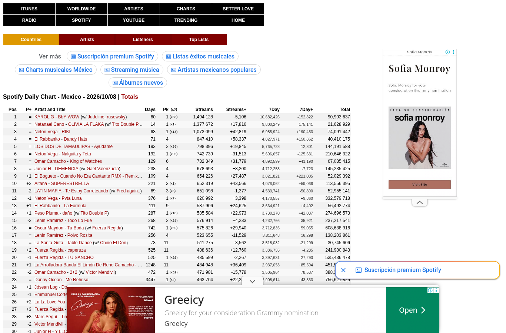
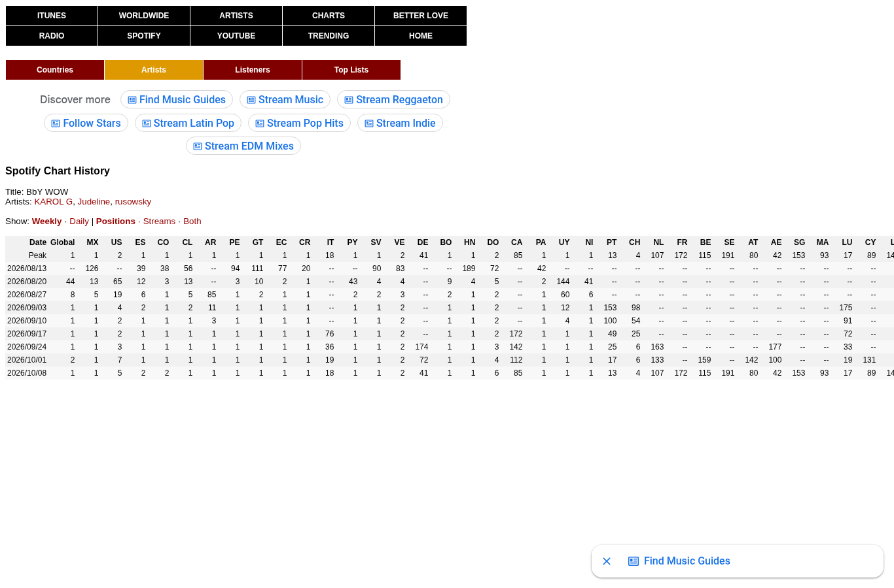
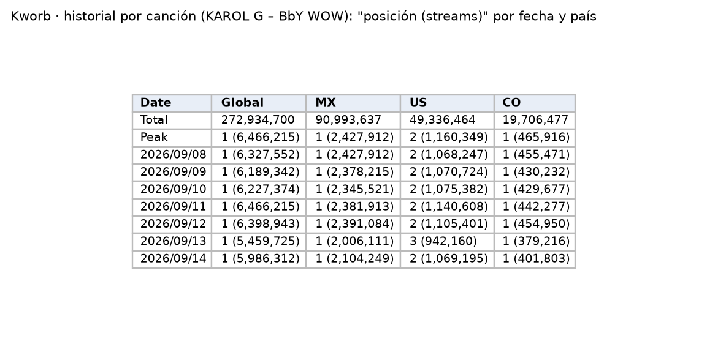
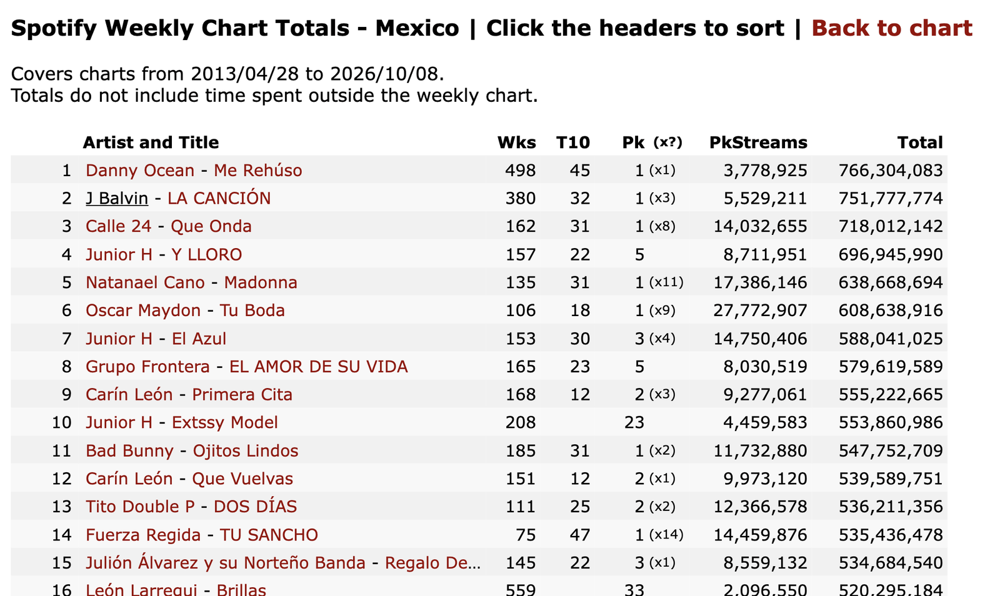
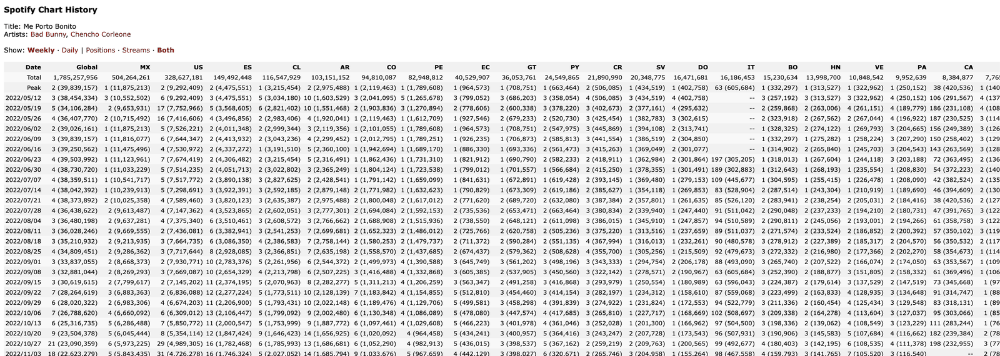

Sitio que recopila diariamente los charts públicos de Spotify. Es la **fuente de streams del almacén para toda la ventana 2015–2025**, a partir del historial semanal de cada canción (ver la [verificación](#evidencia-kworb)). Ofrece dos vistas que usamos:

- **Chart de México:** la lista de las 200 canciones más escuchadas en México en un día. Cada fila es una canción: posición, días en el chart, pico y streams de ese día (figura izquierda).
- **Historial de una canción:** cada fila es una semana (o un día, en la vista diaria) y cada columna un país. Por ejemplo, en el historial de "KAROL G – BbY WOW" (<https://kworb.net/spotify/track/3h5T5JypYU7huFiVYhv1dr.html>) la celda del 8 de septiembre de 2026 en la columna `MX` dice `1 (2,427,912)`: ese día fue la número 1 en México con 2,427,912 streams (figura derecha).

| Campo | Descripción |
|---|---|
| **Nombre y dueño** | Kworb.net, sitio independiente que recopila charts públicos de música (Spotify, YouTube, iTunes, entre otros). |
| **URL** | <https://kworb.net/spotify/country/mx_daily.html> |
| **Acceso** | Páginas HTML públicas. Chart diario: <https://kworb.net/spotify/country/mx_daily.html>. Totales del chart semanal de México, con enlace al historial de cada canción: <https://kworb.net/spotify/country/mx_weekly_totals.html>. |
| **Formato y tamaño** | Tabla HTML; chart diario de 200 filas. |
| **Grano** | Chart: una fila por canción y día. Historial: una fila por semana y canción, con posición y streams por país; la fecha es el jueves en que termina la semana. |
| **Cobertura** | Chart semanal de México del 28 de abril de 2013 al presente, con streams desde la semana del 9 de junio de 2013; 5,146 canciones en la lista de totales semanales. El chart diario está desde 2017. La canción con más tiempo en el chart diario de México acumula 3,447 días. |
| **Información de México** | Página propia "Spotify Daily Chart – Mexico" y columna `MX` en el historial de cada canción. Solo nivel nacional. |
| **Licencia y restricciones** | Sin licencia explícita; datos agregados públicos. Uso académico; no se republican filas crudas. |
| **Llaves de integración** | ID de canción de Spotify: código de 22 caracteres en el enlace de cada canción (en el ejemplo, `3h5T5JypYU7huFiVYhv1dr`); se une exacto con Kaggle. Artista y título: unen con MiSonGyny y LRCLIB, que no tienen ese ID. Fecha: se relaciona con el mes de SESNSP. |
| **Preguntas de E0** | P1, P2, P3. |

::: {layout-ncol=2}



:::

{width=85% fig-align="center"}

{width=60% fig-align="center"}

{width=70% fig-align="center"}

{width=100% fig-align="center"}


## Verificación del historial semanal {#evidencia-kworb}

Se revisó el historial por canción con un script en Colab:

| Qué se revisó | Resultado |
|---|---|
| Lista del chart semanal de México (`mx_weekly_totals`) | 5,146 canciones; cubre del 28 de abril de 2013 al 8 de octubre de 2026 |
| Historial de las 300 canciones con más streams | Posición y streams semanales desde la semana del 9 de junio de 2013 |
| Enero de 2022 a septiembre de 2023, que Kaggle no cubre | Las 91 semanas tienen datos |
| Fechas | Cada fecha es el jueves en que termina la semana (de viernes a jueves) |
| Comparación con Kaggle en 2021, canciones con el mismo ID en las dos fuentes | En 15 de 15 semanas comparables, el streams semanal de Kworb es **idéntico** a la suma de los 7 días de Kaggle; por ejemplo, 16,850,065 en las dos la semana del 29 de abril de 2021. Las 5 semanas de diciembre que no coinciden son días que faltan en Kaggle. |
| `robots.txt` de Kworb | Permite descargar todo el sitio |

Fragmento de la salida del script (la salida completa y el código están en `datos/pruebas/`):

```text
Canciones en la lista semanal de México: 5146
Primera semana con streams: 2013-06-09

Posiciones 1-50 recuperadas por semana (300 canciones), por año:
        min  median  max
2013      1     1.0    2
2017      1     3.0    6
2021      9    12.0   19
2022     21    28.5   38
2023     27    35.5   40
2025     30    37.5   43

Semanas de enero 2022 a septiembre 2023 con datos: 91 de 91
        semana  posicion       kworb  kaggle_7_dias  coincide
2   2021-10-14         1   5502139.0      5502139.0      True
4   2021-04-29         1  16850065.0     16850065.0      True
6   2021-01-28         1   6151122.0      6151122.0      True
1   2021-12-09         1   4088899.0            0.0     False
```

Con esto, Kworb pasa a ser la fuente de streams de toda la ventana y Kaggle se usa para validar. Con 300
canciones se recuperan solo parte de las posiciones de cada semana; la descarga completa de las 5,146 páginas se
hace en la preparación, y una regla de calidad de silver revisa que cada semana quede completa.

## Problemas anticipados para la integración

- El artista, el título y los artistas invitados aparecen juntos en un mismo texto.
- En el historial de cada canción, la posición y el número de reproducciones aparecen juntos en una misma celda.
- Solo hay datos a nivel nacional, por lo que no permite analizar el consumo por entidad.
- La página se actualiza todos los días y no conserva versiones anteriores del chart.
- El historial completo requiere una página por canción: 5,146 páginas, que se descargan a una cada 1.5 segundos y se guardan para no repetir. El `robots.txt` del sitio permite la descarga.
- Una misma canción puede tener otro ID en Kaggle; para validar solo se comparan canciones con el mismo ID.

[← Volver a fuentes de datos](../fuentes.qmd)
