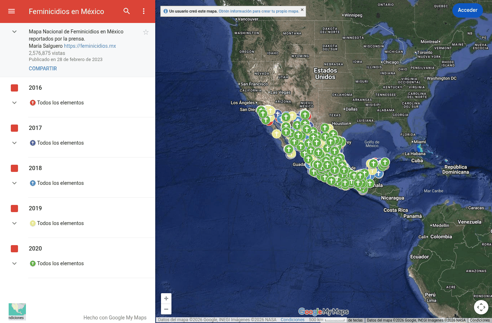
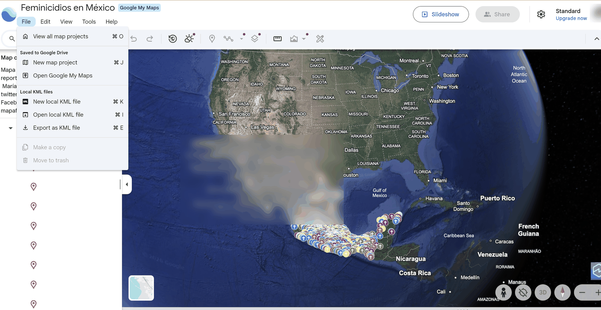
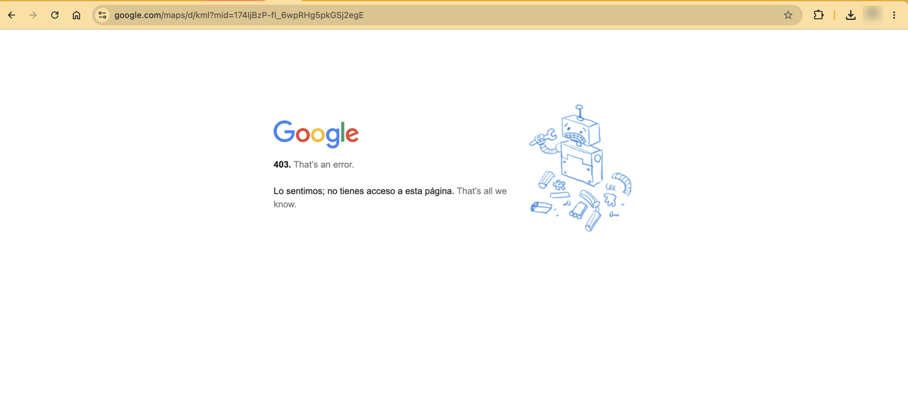

Mapa ciudadano de feminicidios reportados por la prensa. En E0 se planteó como contraste del subregistro del SESNSP. **Se descartó** porque el mapa no permite exportar los datos.

| Campo | Descripción |
|---|---|
| **Nombre y dueño** | "Feminicidios en México", Mapa Nacional de Feminicidios en México reportados por la prensa. Elaborado por la geofísica María Salguero, a partir de notas de prensa desde 2016 [[4]](../referencias.qmd). |
| **URL** | <https://www.google.com/maps/d/viewer?mid=174IjBzP-fl_6wpRHg5pkGSj2egE> |
| **Acceso** | Visualización en Google My Maps; la descarga está restringida. Se intentaron tres vías: el menú del mapa no ofrece descarga; en Google Earth, "Exportar como archivo KML" no descarga nada; y el enlace de exportación de My Maps responde 403 (acceso denegado). El sitio de la autora (feminicidios.mx) ya no responde. |
| **Formato y tamaño** | Mapa con un punto por caso. |
| **Grano** | Un feminicidio reportado en prensa (ubicación y descripción). |
| **Cobertura** | Capas anuales de 2016 a 2020; publicado el 18 de febrero de 2023. |
| **Información de México** | Casos en todo el país. |
| **Licencia y restricciones** | Sin licencia declarada. |
| **Llaves de integración** | Ubicación geográfica (habría que asignarla a entidad) y año. |
| **Decisión** | **Descartada:** cumple C1 y C3, pero no hay archivo que cargar: las tres vías de descarga fallaron (ver Acceso). Además cubre solo 2016–2020 y no declara licencia. |

{width=60% fig-align="center"}

::: {layout-ncol=2}

:::

## Problemas anticipados para la integración

- El mapa no permite exportar los datos; habría que solicitarlos a la autora.
- Solo cubre de 2016 a 2020.
- Los casos están ubicados como puntos en el mapa y no asignados a una entidad.
- Se basa en notas de prensa, con criterios distintos a los de los registros oficiales.

[← Volver a fuentes de datos](../fuentes.qmd)
