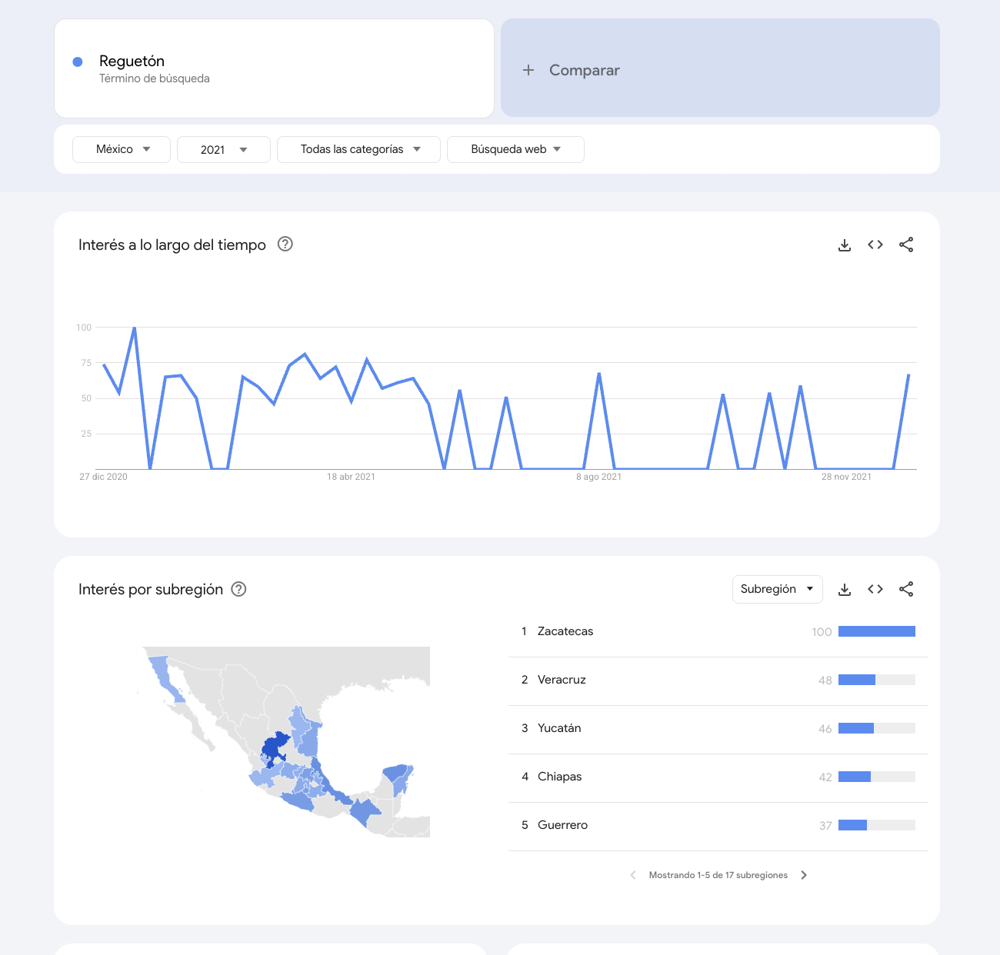

Índice de interés de búsqueda de Google por estado y periodo. Es la única fuente aceptada que aproxima el consumo musical **por entidad**: no mide reproducciones, sino qué tanto se busca un género o artista en cada estado.

| Campo | Descripción |
|---|---|
| **Nombre y dueño** | Google Trends, servicio de Google LLC que publica el interés relativo de búsqueda por región y periodo. |
| **URL** | <https://trends.google.com/trends/explore?geo=MX> |
| **Acceso** | Descarga de CSV desde el sitio, un **tema** por descarga ("Bad Bunny — Cantante", "Reguetón — Género musical"); si no hay tema, el término más común, con el sitio en español (ver la [verificación](#evidencia-trends)). También con la biblioteca `pytrends`, que no es oficial; Google limita el número de consultas. |
| **Formato y tamaño** | Tablas pequeñas por consulta: 32 filas por estado o una fila por periodo. |
| **Grano** | Interés por estado: una fila por estado y término, para todo el periodo consultado. Interés en el tiempo: una fila por mes y término, a nivel nacional. |
| **Cobertura** | Desde 2004 hasta hoy. Prueba: "corridos tumbados", 2017–2025, 108 meses. |
| **Información de México** | 32 estados con código ISO 3166-2 (`MX-ZAC`, `MX-DUR`, …). En la prueba, el interés máximo fue en Zacatecas (100), seguido de Durango (92) y Guanajuato (86). |
| **Licencia y restricciones** | Datos públicos de Google; se cita "Fuente: Google Trends". El acceso con `pytrends` no es una API oficial. |
| **Llaves de integración** | Estado: nombre o código ISO (`MX-ZAC`), que se relaciona con la clave INEGI de la entidad. Periodo: mes o año, que se relaciona con la fecha de SESNSP y de los charts. Término: género o artista, que se relaciona con MusicBrainz y con los charts. |
| **Preguntas de E0** | P1, P2. |

{width=70% fig-align="center"}

{width=70% fig-align="center"}

{width=90% fig-align="center"}


## Verificación de las descargas {#evidencia-trends}

Se descargaron estos archivos desde el sitio (México, desglose por subregión). Están en `datos/trends/` y se
cargan sin cambios en staging.

| Archivo | Qué se descargó | Periodo | Estados con valor |
|---|---|---|---|
| `geoMap_regueton_tema_genero_2021.csv` | Reguetón como **tema** ("Género musical") | 2021 | 32 de 32 |
| `by_region_MX_20210101-0000_20261009-2251.csv` | Reguetón, descarga anterior | 2021 | 32 de 32 |
| `geoMap_regueton_sin_acento_2021.csv` | "Regueton" como **término** | 2021 | 32 de 32 |
| `geoMap_regueton_con_acento_2021.csv` | "Reguetón" como **término** | 2021 | 17 de 32 |
| `by_region_MX_20201231-1800_20261010-0031.csv` | Tones And I y Bobby Pulido en la misma descarga | 2021 | 32 de 32 (Tones And I en cero en 3) |
| `by_region_MX_20260710-0032_20261010-0032.csv` | Tones And I y Bobby Pulido en la misma descarga | 10 de julio a 10 de octubre de 2026 | 32 de 32 (Tones And I en cero en 25) |

Comparación de las descargas de 2021 contra la del tema:

| Descarga | Correlación de rangos (Spearman) | Correlación de valores (Pearson) |
|---|---|---|
| Descarga anterior | 0.99 | 0.99 |
| "Regueton", término | 0.60 | 0.83 |
| "Reguetón", término (17 estados) | 0.64 | 0.39 |

El tema reúne todas las formas de escribir un nombre y es estable: difiere 1 punto en promedio (máximo 5) de la
descarga anterior. Los términos cambian mucho con el acento. Con periodos cortos un artista de poco volumen queda en
cero (Tones And I tiene valor en 29 estados en 2021 y en 7 en tres meses de 2026), por eso las descargas son por
año. El 100 es la ubicación con mayor frecuencia de búsquedas en proporción al total de búsquedas de esa ubicación
[[5]](../referencias.qmd).

### Qué artistas se consultan

Con Kaggle *Spotify Charts* (Top 200 diario de México) se midió qué parte de los streams cubren los artistas más
escuchados de cada año:

```text
Parte de los streams del Top 200 que explican los artistas principales de cada año

2017   Top 50: 66.4%   Top 100: 87.0%
2018   Top 50: 69.9%   Top 100: 88.1%
2019   Top 50: 67.3%   Top 100: 86.7%
2020   Top 50: 73.9%   Top 100: 90.6%
2021   Top 50: 72.1%   Top 100: 89.3%
```

Se consultan los **50 artistas con más streams de cada año** (66–74 % de los streams); con 100 se llegaría al
87–91 %, con el doble de descargas. La selección es por consumo, sin preseleccionar géneros, como pide la regla
operativa de E0. Los demás artistas se reparten con el tema de su género y, si no hay, con los usuarios de internet.

## Problemas anticipados para la integración

- Los valores son relativos, de 0 a 100, y se recalculan en cada consulta, por lo que dos consultas distintas no pueden compararse directamente.
- Cada descarga da un solo valor por estado para todo el periodo consultado; para tener un valor por año hay que hacer una descarga por año.
- Mide búsquedas en Google, no reproducciones de música.
- Algunos nombres de estados no coinciden con los del catálogo del INEGI, y cambian con el idioma del sitio ("Mexico City" en inglés, "Ciudad de México" en español).
- Si una descarga trae varios términos, en la vista por estado los valores de cada estado suman 100 entre los términos y ya no se pueden comparar estados.
- En periodos cortos, los artistas con poco volumen quedan en cero en muchos estados.
- Algunos nombres de artistas son también palabras comunes o nombres de otras personas (Matisse, Aleman, Intocable).
- Un mismo término con y sin acento da resultados distintos ("reguetón" y "regueton"). Descargar el **tema** del artista o del género, y no el término, resuelve la ortografía y la ambigüedad; el término más común queda solo como respaldo cuando no hay tema.

[← Volver a fuentes de datos](../fuentes.qmd)
