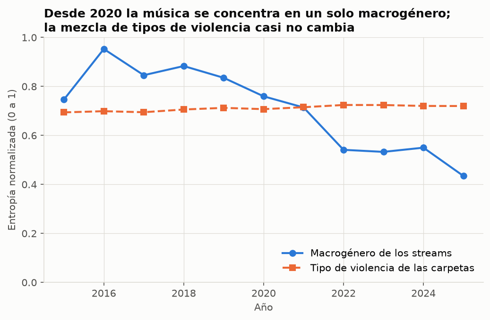

## Decisiones de medición

El valor de estas medidas depende de cómo se calculan, así que conviene decirlo antes de leerlas. En violencia
la unidad es el estado; con municipios el Gini saldría mayor. En música las unidades son las canciones o los
artistas que estuvieron en el chart ese año. Un estado sin carpetas en un año cuenta como una unidad con cero,
mientras que las canciones solo cuentan en los años en que tuvieron streams, porque la muestra no tiene canciones
fuera del chart.

Calculamos el Gini con conteos y con tasas, y para comparar estados usamos las tasas, porque el conteo mezcla la
violencia con el tamaño de la población. La entropía la normalizamos dividiendo entre log₂ K, ya que crece con el
número de categorías, y no agrupamos categorías raras en "otros". En el macrogénero dejamos fuera a los artistas
sin género y reportamos qué parte de los streams sí lo tiene. El Gini que usamos mide concentración de una
cantidad entre unidades y no debe confundirse con el Gini *impurity* de los árboles de decisión.

## Gini y curva de Lorenz

| Variable | Unidad | 2015 | 2019 | 2025 |
|---|---|---|---|---|
| Streams entre canciones | canción | 0.48 | 0.44 | 0.49 |
| Streams entre artistas | artista | 0.49 | 0.47 | **0.66** |
| Feminicidio, conteo | entidad | 0.66 | 0.47 | 0.40 |
| Feminicidio, tasa | entidad | 0.54 | 0.28 | 0.33 |
| Violencia familiar, conteo | entidad | 0.54 | 0.41 | 0.47 |
| Violencia familiar, tasa | entidad | 0.45 | 0.34 | 0.34 |
: Coeficiente de Gini por año (antes de limpiar). La serie completa está en `concentracion_gini.parquet`. {#tbl-gini}

{#fig-lorenz}

{#fig-gini-anio}

En la música, la concentración entre canciones es moderada y estable, con un Gini entre 0.45 y 0.49: las canciones
que entran al chart se escuchan de forma parecida entre sí (@fig-lorenz). Entre artistas, en cambio, el Gini sube de
0.49 a 0.66 (@fig-gini-anio), porque cada vez menos artistas reúnen los streams. Para P1 esto significa que la
proporción misógina del consumo dependerá cada vez más de lo que canten unos pocos artistas.

En la violencia, el feminicidio está más concentrado en conteo que en tasa, con 0.40 frente a 0.33 en 2025. Parte
de la concentración se debe a que los estados grandes tienen más casos, no más riesgo, y por eso P2 usa tasas. La
caída del Gini entre 2015 y 2019 hay que leerla con cuidado: en 2015 varios estados aparecían con cero feminicidios
porque todavía no registraban el delito, lo que infla la desigualdad de ese año; la Parte B lo corrige. La tasa de
violencia familiar está poco concentrada (0.34) y se mantiene estable desde 2019.

## Entropía normalizada

| Año | 2015 | 2016 | 2018 | 2020 | 2022 | 2024 | 2025 |
|---|---|---|---|---|---|---|---|
| Macrogénero de los streams | 0.75 | **0.95** | 0.88 | 0.76 | 0.54 | 0.55 | **0.44** |
| Parte de los streams con género | 0.61 | 0.63 | 0.82 | 0.85 | 0.76 | 0.58 | 0.56 |
| Tipo de violencia de las carpetas | 0.69 | 0.70 | 0.71 | 0.71 | 0.72 | 0.72 | 0.72 |
: Entropía normalizada por año. La serie completa está en `concentracion_entropia.parquet`. {#tbl-entropia}

{#fig-entropia}

La entropía del macrogénero baja de 0.95 en 2016, cuando el consumo se repartía casi por igual entre los géneros,
a 0.44 en 2025, cuando el regional mexicano llegó a 75 % de los streams con género (@fig-entropia). El consumo de la
muestra se volvió mucho menos diverso, lo que importa para P1 y P3. Hay que leerlo con dos precauciones: según el
año, solo entre 56 y 85 % de los streams tiene género, y los primeros años dependen de pocas canciones.

La mezcla de tipos de violencia casi no cambia, de 0.69 a 0.72, aunque el volumen se haya duplicado: los tipos
crecen juntos, y para P4 eso permite usar una sola distribución oficial. Entre estados sí hay diferencias: en 2025 la entropía va de 0.57 en Morelos, Nuevo León
y la Ciudad de México, donde la violencia familiar es más del 70 % de las carpetas, 0.82 en Yucatán y Campeche y
0.86 en Tlaxcala, donde ningún tipo pasa del 44 %. La violencia familiar es el tipo predominante en 25 estados,
la física en 6 y la sexual en uno (Chiapas).
