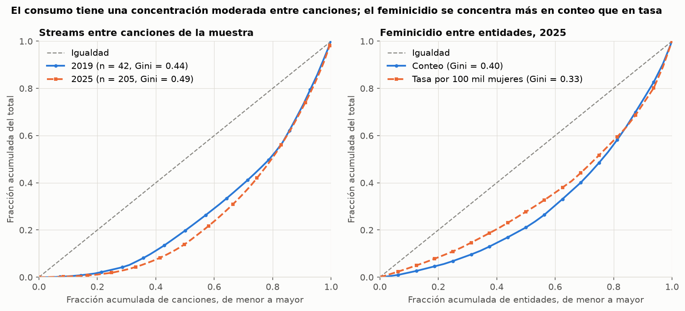
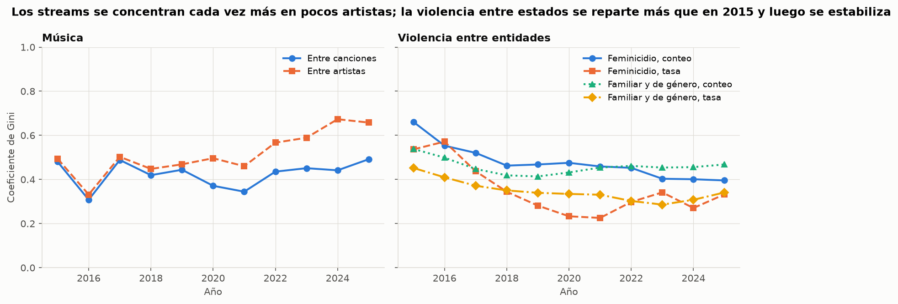

## Decisiones de medición

Antes de leer los valores hay que declarar cómo se calcularon, porque cambian el resultado:

- **Unidad de agregación.** En violencia la unidad es la **entidad** (32 unidades); con municipios el Gini sería
  mayor. En música las unidades son las **canciones** o los **artistas** que estuvieron en el chart ese año.
- **Ceros.** Una entidad sin carpetas en un año **cuenta** como unidad con cero. Las canciones solo cuentan en
  los años en que tuvieron streams (la muestra no tiene canciones fuera del chart).
- **Conteos frente a tasas.** Se calculan los dos. Para comparar estados se usa la **tasa**: el conteo mezcla la
  violencia con el tamaño de la población.
- **Entropía.** Se normaliza por log₂ K porque crece con el número de categorías. No se agruparon categorías raras
  en "Otros". En el macrogénero se excluyen los artistas sin género y se reporta qué parte de los streams cubre.
- Este Gini mide **concentración** de una cantidad entre unidades; no es el Gini *impurity* de los árboles de
  decisión.

## Gini y curva de Lorenz

| Variable | Unidad | 2015 | 2019 | 2025 |
|---|---|---|---|---|
| Streams entre canciones | canción | 0.48 | 0.44 | 0.49 |
| Streams entre artistas | artista | 0.49 | 0.47 | **0.66** |
| Feminicidio, conteo | entidad | 0.66 | 0.47 | 0.40 |
| Feminicidio, tasa | entidad | 0.54 | 0.28 | 0.33 |
| Violencia familiar, conteo | entidad | 0.54 | 0.41 | 0.47 |
| Violencia familiar, tasa | entidad | 0.45 | 0.34 | 0.34 |
: Coeficiente de Gini por año (antes de limpiar). La serie completa está en `concentracion_gini.parquet`. {#tbl-gini}

{#fig-lorenz}

{#fig-gini-anio}

**Música (P1, P3).** Entre canciones la concentración es moderada y estable (Gini cercano a 0.45–0.49): las
canciones que entran al chart se escuchan de forma parecida entre sí (@fig-lorenz). Entre **artistas** la
concentración sube de 0.49 a 0.66 (@fig-gini-anio): cada vez menos artistas reúnen los streams. Para P1 esto
significa que la proporción misógina del consumo dependerá cada vez más de lo que canten unos pocos artistas.

**Violencia (P2).** El feminicidio está más concentrado en conteo que en tasa (0.40 frente a 0.33 en 2025): una
parte de la concentración es que los estados grandes tienen más casos, no más riesgo. Por eso P2 usa tasas. La
caída del Gini de 2015 a 2019 hay que leerla con cuidado: en 2015 varios estados aparecían con cero feminicidios
porque todavía no registraban el delito, lo que infla la desigualdad de ese año; la Parte B lo corrige. En la
violencia familiar la tasa se concentra poco (0.34) y estable desde 2019.

## Entropía normalizada

| Año | 2015 | 2016 | 2018 | 2020 | 2022 | 2024 | 2025 |
|---|---|---|---|---|---|---|---|
| Macrogénero de los streams | 0.75 | **0.95** | 0.88 | 0.76 | 0.54 | 0.55 | **0.44** |
| Parte de los streams con género | 0.61 | 0.63 | 0.82 | 0.85 | 0.76 | 0.58 | 0.56 |
| Tipo de violencia de las carpetas | 0.69 | 0.70 | 0.71 | 0.71 | 0.72 | 0.72 | 0.72 |
: Entropía normalizada por año. La serie completa está en `concentracion_entropia.parquet`. {#tbl-entropia}

{#fig-entropia}

**Macrogénero (P1, P3).** La entropía baja de 0.95 en 2016, cuando el consumo se repartía casi por igual entre
los géneros, a 0.44 en 2025: el regional mexicano pasó de 35 % a 75 % de los streams con género (@fig-entropia).
El consumo de la muestra se volvió mucho menos diverso. Dos precauciones: según el año solo entre 56 y 85 % de los
streams tiene género, y los primeros años salen de pocas canciones.

**Tipo de violencia (P4).** La mezcla de tipos casi no cambia (0.69 a 0.72) aunque el volumen se haya
duplicado: crecen juntos. Entre estados sí hay diferencias: en 2025 la entropía va de 0.57 en Morelos, Nuevo León
y la Ciudad de México, donde la violencia familiar es más del 70 % de las carpetas, 0.82 en Yucatán y Campeche y
0.86 en Tlaxcala, donde ningún tipo pasa del 44 %. La violencia familiar es el tipo predominante en 25 estados,
la física en 6 y la sexual en uno (Chiapas).
