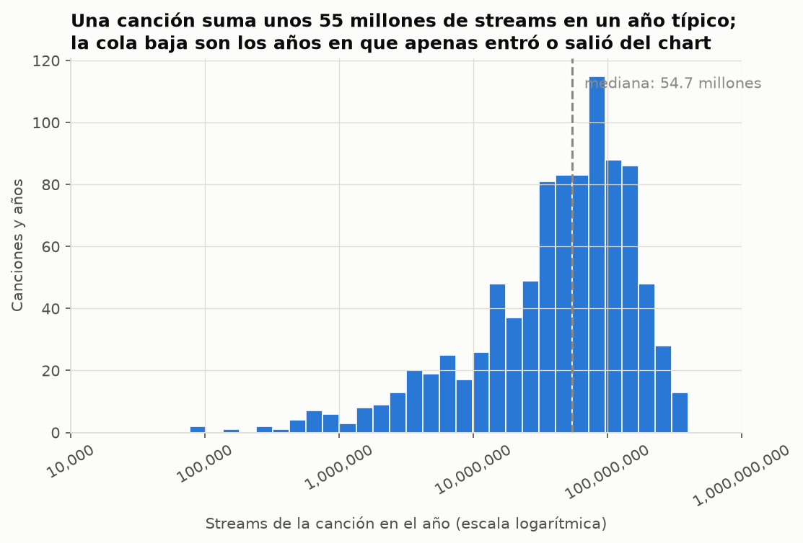
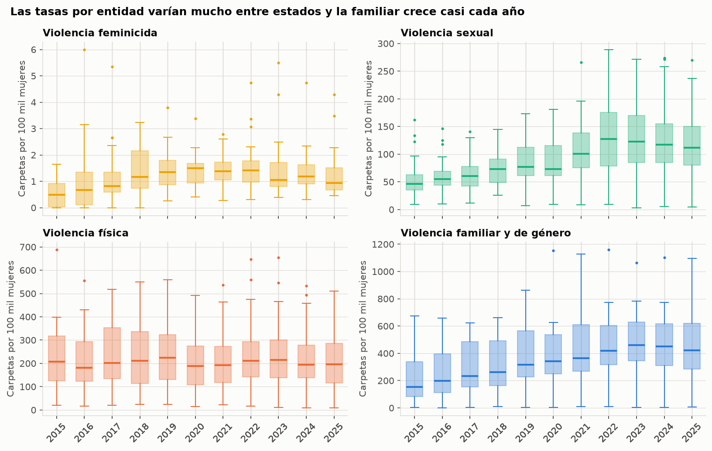
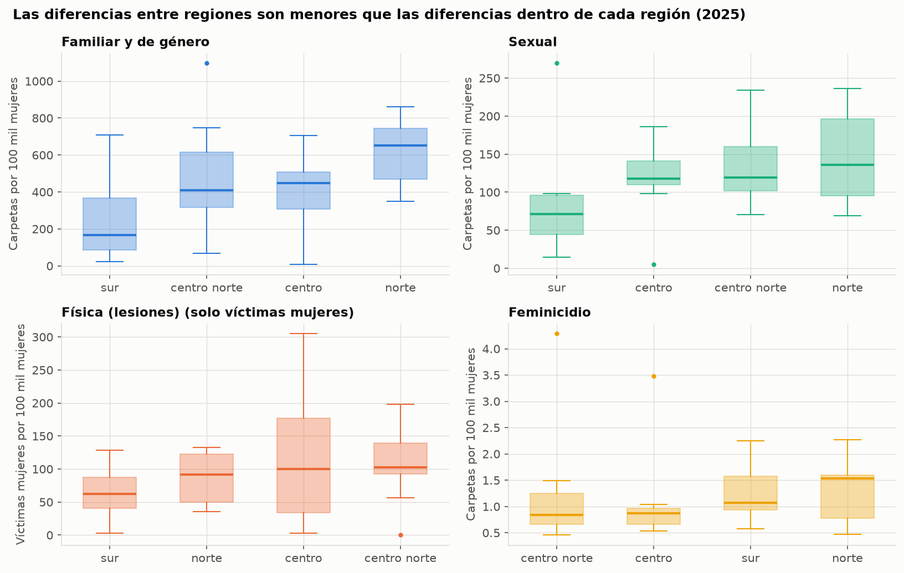
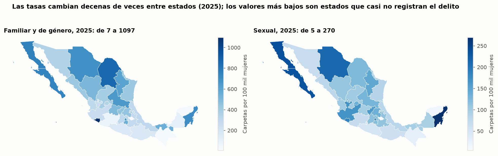
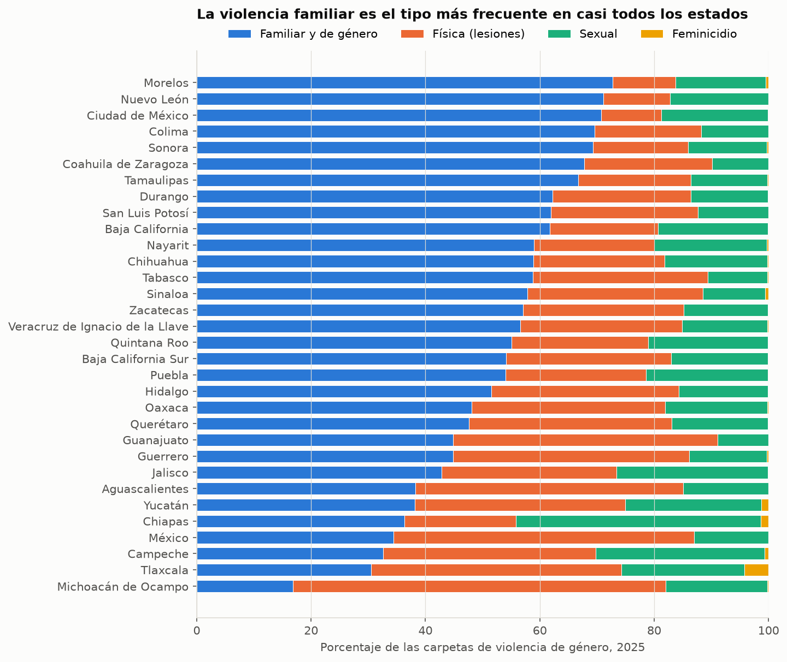

Cada variable relevante se describe en sus cuatro dimensiones. Las tasas de violencia son **por 100 mil mujeres**
(población de CONAPO del mismo año y entidad), con una observación por entidad y año (32 × 11 = 352); los streams
son de la muestra de Kworb. Las medidas completas están en `pipeline/data/data-processed/eda/descriptiva_*.parquet`.

## Localización

| Variable | Unidad | n | Media | Mediana | Media recortada 10 % | Q1 | Q3 | P90 |
|---|---|---|---|---|---|---|---|---|
| Streams por canción y año | canción-año en el chart | 922 | 74.8 M | 54.7 M | 64.0 M | 20.3 M | 106.0 M | 166.7 M |
| Tasa de violencia familiar y de género | entidad-año | 352 | 367.1 | 348.3 | 356.0 | 166.8 | 547.7 | 673.0 |
| Tasa de violencia sexual | entidad-año | 352 | 94.0 | 80.4 | 88.2 | 51.0 | 125.3 | 173.4 |
| Tasa de víctimas mujeres de lesiones | entidad-año | 352 | 92.0 | 85.3 | 85.9 | 44.4 | 128.9 | 173.1 |
| Tasa de feminicidio | entidad-año | 352 | 1.28 | 1.14 | 1.18 | 0.68 | 1.63 | 2.34 |
| Usuarios de internet (%) | entidad-año | 320 | 72.3 | 75.1 | 73.3 | 62.7 | 83.5 | 87.5 |
| Pobreza (%) | entidad-año medido | 128 | 39.8 | 38.7 | 39.0 | 27.0 | 50.3 | 60.2 |
| Impunidad del feminicidio (%) | entidad, 2023 | 23 | 79.9 | 90.6 | 83.5 | 62.8 | 99.1 | 100.0 |
: Medidas de localización {#tbl-localizacion}

**Lectura.** Una canción que está en el chart suma unos 55 millones de streams en un año típico (mediana), pero la
media sube a 75 millones porque unas pocas canciones acumulan cientos de millones. En violencia, la entidad típica
registra unas 350 carpetas de violencia familiar por cada 100 mil mujeres al año: es, por mucho, el delito de
violencia de género más denunciado, cuatro veces la tasa sexual. La moda no aporta en las tasas (casi no hay
valores repetidos), así que no se usa para interpretar; en la impunidad la moda es 100 %: varias entidades no
resuelven ningún caso de feminicidio según México Evalúa.

## Variabilidad y forma

| Variable | DE | IQR | MAD | CV | Asimetría | Curtosis | Media / mediana | DE / (IQR/1.349) |
|---|---|---|---|---|---|---|---|---|
| Streams por canción y año | 70.6 M | 85.7 M | 39.9 M | 0.94 | 1.47 | 2.37 | **1.37** | 1.11 |
| Streams por canción y mes | 9.1 M | 7.7 M | 3.6 M | 0.97 | 2.61 | 10.39 | **1.34** | **1.59** |
| Tasa familiar y de género | 239.0 | 380.9 | 187.8 | 0.65 | 0.51 | 0.05 | 1.05 | 0.85 |
| Tasa sexual | 57.6 | 74.2 | 35.2 | 0.61 | 0.99 | 0.89 | 1.17 | 1.05 |
| Tasa de víctimas mujeres de lesiones | 66.8 | 84.5 | 43.4 | 0.73 | 0.99 | 1.58 | 1.08 | 1.07 |
| Tasa de feminicidio | 0.91 | 0.95 | 0.48 | 0.71 | 1.68 | 4.86 | 1.12 | **1.29** |
| Usuarios de internet (%) | 13.5 | 20.8 | 9.7 | 0.19 | −0.65 | −0.34 | 0.96 | 0.88 |
| Pobreza (%) | 15.0 | 23.2 | 11.7 | 0.38 | 0.44 | −0.58 | 1.03 | 0.87 |
: Variabilidad y forma. CV = DE/media; curtosis en exceso (0 en una normal). La última columna compara la DE con la que tendría una normal con el mismo IQR: mayor a 1 indica colas pesadas o atípicos. {#tbl-variabilidad}

**Media frente a mediana: ¿hay sesgo?** Los streams tienen una media 34–37 % mayor que la mediana y asimetría
positiva: la distribución tiene una cola larga a la derecha formada por los grandes éxitos (@fig-streams). Las
tasas de violencia están mucho más cerca de la simetría (media/mediana de 1.05 a 1.17), salvo el feminicidio,
cuya cola derecha son unos pocos estados con tasas de 4 a 6 por 100 mil.

**Desviación estándar frente a IQR: ¿hay atípicos?** En los streams mensuales la DE es 1.6 veces la que tendría
una normal con el mismo IQR y la curtosis es 10: hay meses atípicos (los estrenos y los picos de un éxito). En el
feminicidio la razón es 1.3: algunos estados se separan del resto. En las tasas familiar y sexual la razón es
cercana o menor a 1: la dispersión es amplia pero pareja, sin unos pocos valores extremos.

**Coeficiente de variación.** Las tasas de violencia varían entre entidades y años alrededor de 60–70 % de su
media, mucho más que los indicadores de contexto (19 % internet, 38 % pobreza). La violencia registrada es más
desigual entre estados que las condiciones socioeconómicas que la acompañan.

{#fig-streams}

## Comparación entre grupos

### Por año

| Tasa (por 100 mil mujeres) | 2015 | 2019 | 2023 | 2025 | η² | ω² |
|---|---|---|---|---|---|---|
| Familiar y de género | 152.1 | 315.2 | 460.3 | 422.4 | 0.12 | 0.09 |
| Sexual | 46.5 | 77.0 | 123.0 | 111.5 | **0.24** | **0.21** |
| Víctimas mujeres de lesiones | 78.9 | 92.6 | 93.9 | 91.6 | 0.01 | −0.02 |
| Feminicidio | 0.50 | 1.35 | 1.05 | 0.93 | 0.09 | 0.06 |
: Mediana entre entidades por año y parte de la variación explicada por el año (η²; ω² corrige el sesgo de η²) {#tbl-anio}

La mediana estatal de violencia familiar se triplicó de 2015 a 2023 y la sexual se multiplicó por 2.6; el año
explica el 24 % de la variación de la tasa sexual, lo que la hace la que más cambió en el tiempo
(@fig-tasas-anio, @fig-series). La violencia física contra mujeres, medida con las víctimas, no cambia
(η² ≈ 0). El feminicidio sube hasta 2019–2021 y luego baja, pero su valor de 2015 está subestimado por los
estados que todavía no registraban el delito (ver [calidad del SESNSP](calidad/f01_sesnsp.qmd)). En todos los
tipos 2024–2025 queda por debajo de 2023; puede ser una baja real o meses recientes que el SESNSP aún actualiza.

{#fig-tasas-anio}

{#fig-series}

### Por región del Banco de México (2025)

| Tasa 2025 | Sur | Centro | Centro norte | Norte | η² |
|---|---|---|---|---|---|
| Familiar y de género | **165.5** | 449.1 | 407.7 | **652.3** | 0.22 |
| Sexual | 71.5 | 118.0 | 119.5 | 136.0 | 0.11 |
| Víctimas mujeres de lesiones | 62.5 | 100.0 | 102.9 | 91.4 | 0.11 |
| Feminicidio | 1.07 | 0.87 | 0.84 | 1.54 | 0.01 |
: Mediana por región y parte de la variación entre estados que explica la región {#tbl-region}

El sur registra cuatro veces menos violencia familiar que el norte, pero la región explica solo el 22 % de las
diferencias: dentro de cada región los estados difieren mucho más (@fig-region). El mapa (@fig-mapa) y la mezcla
de tipos por estado (@fig-tipos) muestran por qué: los valores más bajos son estados como **Tlaxcala**
(7 carpetas por 100 mil mujeres), **Yucatán** (23), **Chiapas** (26) y **Michoacán** (67), que casi no
clasifican denuncias como violencia familiar y las registran como lesiones. Las diferencias entre estados mezclan
violencia real con prácticas de registro de cada fiscalía. En el feminicidio la región no explica nada (η² = 0.01).

{#fig-region}

{#fig-mapa}

### Por macrogénero

Los streams anuales por canción (en log10) apenas difieren entre géneros: el macrogénero explica el 4.6 % de la
variación (η² = 0.046). Una canción de regional mexicano o de urbano latino no es más escuchada que una de pop;
lo que cambia entre géneros es **cuántas** canciones entran al chart, no cuánto se escucha cada una.

## Variables categóricas

| Variable | Medida sobre | Moda | K | Proporción de la moda | Entropía normalizada | Categorías efectivas (Hill 1) |
|---|---|---|---|---|---|---|
| Tipo de violencia (LGAMVLV) | carpetas | familiar y de género | 4 | 0.51 | 0.72 | 2.7 |
| Subtipo de delito | carpetas | Violencia familiar | 55 | 0.11 | 0.78 | 22.6 |
| Macrogénero | streams | regional mexicano | 8 | 0.36 | 0.67 | 4.1 |
| Macrogénero | canciones | regional mexicano | 8 | 0.35 | 0.70 | 4.3 |
| País del artista | canciones | sin dato | 12 | 0.39 | 0.63 | 4.8 |
: Heterogeneidad de las variables categóricas {#tbl-categoricas}

La violencia familiar es la mitad de las carpetas de violencia de género; con 4 tipos, hay en la práctica 2.7
tipos "efectivos". El macrogénero se reparte entre unos 4 géneros efectivos en toda la ventana, pero esa cifra
global esconde una concentración creciente año con año (ver [concentración](eda_concentracion.qmd)). El país del
artista tiene como moda "sin dato": el 39 % de las canciones no tiene país en MusicBrainz, así que esa variable
sirve poco para el análisis.

{#fig-macrogeneros}

{#fig-tipos}

La @fig-macrogeneros muestra que el regional mexicano y el urbano latino suman más de la mitad del consumo de la
muestra, y que una parte grande no tiene género asignado. La @fig-tipos confirma que la violencia familiar es el
tipo más frecuente en 25 de los 32 estados. En 6 domina la física (entre ellos Michoacán, Tlaxcala, Campeche y el
Estado de México) y en Chiapas la sexual: es la otra cara del problema de clasificación descrito arriba, porque
lo que un estado registra como violencia familiar otro lo registra como lesiones.
