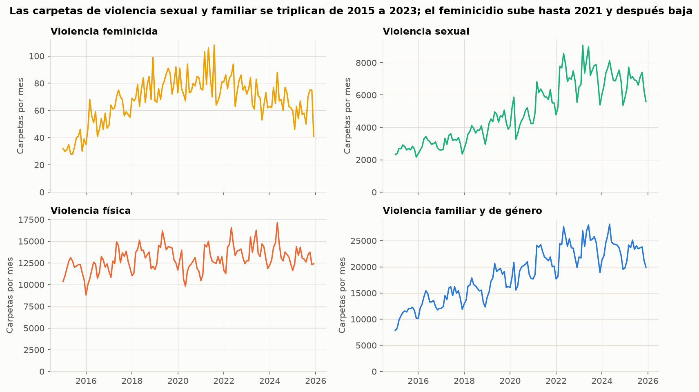
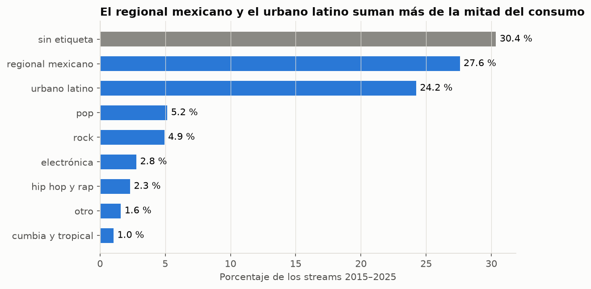

Cada variable relevante se describe en sus cuatro dimensiones. Las tasas de violencia son **por 100 mil mujeres**
(población de CONAPO del mismo año y entidad), con una observación por entidad y año (32 × 11 = 352); los streams
son del Top 200 semanal completo de Kworb (5,177 canciones). Las medidas completas están en `pipeline/data/data-processed/eda/descriptiva_*.parquet`.

## Localización

| Variable | Unidad | n | Media | Mediana | Media recortada 10 % | Q1 | Q3 | P90 |
|---|---|---|---|---|---|---|---|---|
| Streams por canción y año | canción-año en el chart | 7,299 | 20.1 M | 5.8 M | 11.5 M | 1.4 M | 22.6 M | 54.4 M |
| Tasa de violencia familiar y de género | entidad-año | 352 | 367.1 | 348.3 | 356.0 | 166.8 | 547.7 | 673.0 |
| Tasa de violencia sexual | entidad-año | 352 | 94.0 | 80.4 | 88.2 | 51.0 | 125.3 | 173.4 |
| Tasa de víctimas mujeres de lesiones | entidad-año | 352 | 92.0 | 85.3 | 85.9 | 44.4 | 128.9 | 173.1 |
| Tasa de feminicidio | entidad-año | 352 | 1.28 | 1.14 | 1.18 | 0.68 | 1.63 | 2.34 |
| Usuarios de internet (%) | entidad-año | 320 | 72.3 | 75.1 | 73.3 | 62.7 | 83.5 | 87.5 |
| Pobreza (%) | entidad-año medido | 128 | 39.8 | 38.7 | 39.0 | 27.0 | 50.3 | 60.2 |
| Impunidad del feminicidio (%) | entidad, 2023 | 23 | 79.9 | 90.6 | 83.5 | 62.8 | 99.1 | 100.0 |
: Medidas de localización {#tbl-localizacion}

En un año típico, una canción que está en el chart suma unos 6 millones de streams, pero la media sube a 20
millones porque unas pocas canciones acumulan cientos de millones: el 10 % más escuchado pasa de 54 millones. En violencia, el estado típico registra unas 350
carpetas de violencia familiar por cada 100 mil mujeres al año, cuatro veces la tasa sexual: es por mucho el delito
de violencia de género más denunciado. La moda casi no dice nada en las tasas, porque apenas hay valores repetidos,
así que no la usamos para interpretar. La excepción es la impunidad, donde la moda es 100 %: según México Evalúa,
varios estados no resuelven ningún caso de feminicidio.

## Variabilidad y forma

| Variable | DE | IQR | MAD | CV | Asimetría | Curtosis | Media / mediana | DE / (IQR/1.349) |
|---|---|---|---|---|---|---|---|---|
| Streams por canción y año | 36.9 M | 21.2 M | 5.3 M | 1.83 | 3.91 | 20.97 | **3.46** | **2.34** |
| Streams por canción y mes | 5.9 M | 5.0 M | 2.0 M | 1.30 | 3.77 | 23.87 | **1.66** | **1.60** |
| Tasa familiar y de género | 239.0 | 380.9 | 187.8 | 0.65 | 0.51 | 0.05 | 1.05 | 0.85 |
| Tasa sexual | 57.6 | 74.2 | 35.2 | 0.61 | 0.99 | 0.89 | 1.17 | 1.05 |
| Tasa de víctimas mujeres de lesiones | 66.8 | 84.5 | 43.4 | 0.73 | 0.99 | 1.58 | 1.08 | 1.07 |
| Tasa de feminicidio | 0.91 | 0.95 | 0.48 | 0.71 | 1.68 | 4.86 | 1.12 | **1.29** |
| Usuarios de internet (%) | 13.5 | 20.8 | 9.7 | 0.19 | −0.65 | −0.34 | 0.96 | 0.88 |
| Pobreza (%) | 15.0 | 23.2 | 11.7 | 0.38 | 0.44 | −0.58 | 1.03 | 0.87 |
: Variabilidad y forma. CV = DE/media; curtosis en exceso (0 en una normal). La última columna compara la DE con la que tendría una normal con el mismo IQR: mayor a 1 indica colas pesadas o atípicos. {#tbl-variabilidad}

Comparar la media con la mediana muestra si hay sesgo. En los streams la media es 1.7 veces la mediana por mes y 3.5
veces por año, con asimetría cercana a 4, así que la distribución tiene una cola larga a la derecha formada por los
grandes éxitos (@fig-streams). Las tasas de violencia están mucho más cerca de la simetría, con razones de 1.05 a
1.17, salvo el feminicidio, cuya cola la forman unos pocos estados con tasas de 4 a 6 por 100 mil.

Comparar la desviación estándar con el IQR muestra si hay atípicos. En los streams la desviación es 1.6 veces (por
mes) y 2.3 veces (por año) la que tendría una normal con el mismo IQR, y la curtosis pasa de 20, lo que confirma
valores atípicos: los estrenos y los picos de un éxito. En el feminicidio la razón es 1.3, porque algunos estados se separan del resto.
En las tasas familiar y sexual la razón es cercana o menor a 1, es decir, la dispersión es amplia pero pareja y no
depende de unos pocos valores extremos.

El coeficiente de variación de las tasas de violencia ronda el 60 o 70 %, mucho más que el de los indicadores de
contexto (19 % en internet y 38 % en pobreza). La violencia registrada es más desigual entre estados que las
condiciones socioeconómicas que la acompañan.

{#fig-streams}

## Comparación entre grupos

### Por año

| Tasa (por 100 mil mujeres) | 2015 | 2019 | 2023 | 2025 | η² | ω² |
|---|---|---|---|---|---|---|
| Familiar y de género | 152.1 | 315.2 | 460.3 | 422.4 | 0.12 | 0.09 |
| Sexual | 46.5 | 77.0 | 123.0 | 111.5 | **0.24** | **0.21** |
| Víctimas mujeres de lesiones | 78.9 | 92.6 | 93.9 | 91.6 | 0.01 | −0.02 |
| Feminicidio | 0.50 | 1.35 | 1.05 | 0.93 | 0.09 | 0.06 |
: Mediana entre entidades por año y parte de la variación explicada por el año (η²; ω² corrige el sesgo de η²) {#tbl-anio}

La mediana estatal de violencia familiar se triplicó de 2015 a 2023 y la sexual se multiplicó por 2.6; el año
explica el 24 % de la variación de la tasa sexual, lo que la hace la que más cambió en el tiempo
(@fig-tasas-anio, @fig-series). La violencia física contra mujeres, medida con las víctimas, no cambia
(η² ≈ 0). El feminicidio sube hasta 2019–2021 y luego baja, pero su valor de 2015 está subestimado por los
estados que todavía no registraban el delito (ver [calidad del SESNSP](calidad/f01_sesnsp.qmd)). En todos los
tipos 2024–2025 queda por debajo de 2023; puede ser una baja real o meses recientes que el SESNSP aún actualiza.

{#fig-tasas-anio}

{#fig-series}

### Por región del Banco de México (2025)

| Tasa 2025 | Sur | Centro | Centro norte | Norte | η² |
|---|---|---|---|---|---|
| Familiar y de género | **165.5** | 449.1 | 407.7 | **652.3** | 0.22 |
| Sexual | 71.5 | 118.0 | 119.5 | 136.0 | 0.11 |
| Víctimas mujeres de lesiones | 62.5 | 100.0 | 102.9 | 91.4 | 0.11 |
| Feminicidio | 1.07 | 0.87 | 0.84 | 1.54 | 0.01 |
: Mediana por región y parte de la variación entre estados que explica la región {#tbl-region}

El sur registra cuatro veces menos violencia familiar que el norte, pero la región explica solo el 22 % de las
diferencias: dentro de cada región los estados difieren mucho más (@fig-region). El mapa (@fig-mapa) y la mezcla
de tipos por estado (@fig-tipos) muestran por qué: los valores más bajos son estados como **Tlaxcala**
(7 carpetas por 100 mil mujeres), **Yucatán** (23), **Chiapas** (26) y **Michoacán** (67), que casi no
clasifican denuncias como violencia familiar y las registran como lesiones. Las diferencias entre estados mezclan
violencia real con prácticas de registro de cada fiscalía. En el feminicidio la región no explica nada (η² = 0.01).

{#fig-region}

{#fig-mapa}

### Por macrogénero

Los streams anuales por canción, en escala logarítmica, difieren poco entre géneros: el macrogénero explica el
8.8 % de la variación (η² = 0.088). Aun así, la diferencia típica es grande: la mediana de una canción de regional
mexicano o de urbano latino ronda los 10 millones de streams al año, contra 2 millones en el pop. Esos dos géneros
no solo meten más canciones al chart, también las mantienen más tiempo.

## Variables categóricas

| Variable | Medida sobre | Moda | K | Proporción de la moda | Entropía normalizada | Categorías efectivas (Hill 1) |
|---|---|---|---|---|---|---|
| Tipo de violencia (LGAMVLV) | carpetas | familiar y de género | 4 | 0.51 | 0.72 | 2.7 |
| Subtipo de delito | carpetas | Violencia familiar | 55 | 0.11 | 0.78 | 22.6 |
| Macrogénero | streams | regional mexicano | 8 | 0.40 | 0.72 | 4.5 |
| Macrogénero | canciones | urbano latino | 8 | 0.26 | 0.88 | 6.2 |
| País del artista | canciones | sin dato | 41 | 0.28 | 0.61 | 9.7 |
: Heterogeneidad de las variables categóricas {#tbl-categoricas}

La violencia familiar reúne la mitad de las carpetas de violencia de género, de modo que, aunque hay cuatro
tipos, en la práctica equivalen a 2.7 tipos repartidos por igual. Sin contar a los artistas sin género, el macrogénero se reparte
entre unos cuatro géneros efectivos por streams y seis por canciones: el urbano latino tiene más canciones, pero el
regional mexicano suma más streams, porque domina los años recientes, cuando el consumo total es mayor. Esa cifra
global esconde dos olas de concentración, descritas en [Concentración y heterogeneidad](eda_concentracion.qmd). En
el país del artista la categoría más frecuente es "sin dato": el 28 % de las canciones no tiene país en MusicBrainz.

{#fig-macrogeneros}

{#fig-tipos}

La @fig-macrogeneros muestra que el regional mexicano y el urbano latino suman más de la mitad del consumo, y que
cerca de un tercio de los streams no tiene género asignado. La @fig-tipos confirma que la violencia familiar es el
tipo más frecuente en 25 de los 32 estados. En 6 domina la física (entre ellos Michoacán, Tlaxcala, Campeche y el
Estado de México) y en Chiapas la sexual: es la otra cara del problema de clasificación descrito arriba, porque
lo que un estado registra como violencia familiar otro lo registra como lesiones.
