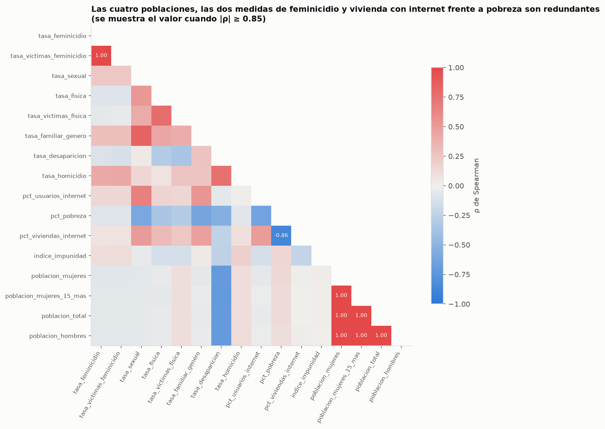
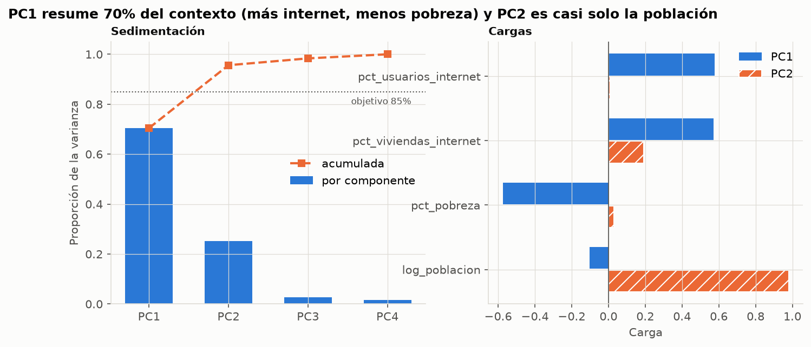
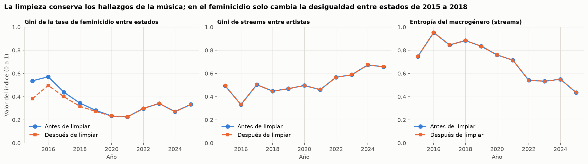

La preparación parte de lo que encontró el [análisis exploratorio](eda.qmd). Cada tratamiento se diagnosticó
primero, se aplicó con una regla declarada en `pipeline/config.yaml` o en el código, y quedó en el **registro de
limpieza** con su conteo y su justificación. El pipeline lo vuelve a escribir en cada corrida
(`pipeline/logs/registro_limpieza.csv`).

## Calidad y tratamiento del ruido

La tabla resume los problemas por tipo, en el orden que propone la entrega. El detalle de cada fuente está en
[Calidad por fuente](calidad.qmd).

| Problema | Qué encontramos | Qué decidimos y por qué |
|---|---|---|
| Valores faltantes | El SESNSP no reporta víctimas de delitos sexuales ni de violencia familiar (38,016 filas), el 11.3 % de las víctimas no tiene sexo y el 10.2 % de las mujeres no tiene edad. En el RNPDNO, el 70 % de las mujeres no tiene fecha o entidad y la fuente termina en agosto de 2023. Cada indicador de contexto existe solo en sus años de medición. | Distinguimos los ceros estructurales, cuando la fuente no mide el dato, de los faltantes, cuando el dato existe pero no se conoce. No imputamos víctimas, sexo ni edad porque eso inventaría personas, y no rellenamos con cero los meses sin RNPDNO. En el contexto interpolamos entre mediciones y repetimos la más cercana en los extremos, porque esos indicadores cambian despacio; la ENDIREH queda vacía fuera de 2016 y 2021. |
| Ceros que en realidad faltan | Ocho estados empiezan la serie de feminicidio con 12 meses o más en cero (900 celdas). | Convertimos esos ceros en faltantes, porque la fiscalía todavía no clasificaba el delito y un cero diría que no hubo feminicidios. |
| Duplicados | No hay llaves repetidas en las fuentes que tienen llave. Hay filas idénticas en el RNPDNO (4,354) y en la ENDUTIH (1,146). | Las conservamos. Ninguna de las dos fuentes trae un identificador de persona, y en el RNPDNO casi todas esas filas están testadas: son personas distintas que se ven iguales. |
| Atípicos | Hay 553 meses de streams fuera de las cercas de Tukey, 320 meses de violencia atípicos dentro de su estado (\|z robusto\| > 3.5) y 625 fuera de las cercas entre estados. El RNPDNO tiene 7 edades mayores a 110 años. | Conservamos los atípicos de streams y de violencia, porque los éxitos y los picos de denuncias son el fenómeno de P1 y P2; comparamos los streams en escala logarítmica y la violencia en tasas. Las edades imposibles pasan a faltantes, porque una edad de 1,832 años es un error de captura. |
| Categorías inconsistentes | Los nombres de entidad cambian entre fuentes (ESTADO DE MEXICO, VERACRUZ, DISTRITO FEDERAL), 325,248 filas son delitos sin relación con la violencia de género y el encabezado de MiSonGyny se cargó como dato. | Unimos las entidades con una tabla de equivalencias a la clave INEGI, sin perder filas; excluimos los delitos fuera del mapeo de la LGAMVLV de E1, porque no responden P1–P4, y eliminamos el encabezado. |
| Tipos, unidades y rangos | Todo llega como texto, las celdas de Kworb mezclan posición y streams, y las semanas cruzan de un mes a otro. | Convertimos los tipos, separamos la celda y repartimos cada semana entre meses según sus días, lo que conserva exacta la suma de streams. |
| Llaves que no coinciden | 258 de 300 canciones no están en MiSonGyny, 18 búsquedas de MusicBrainz devolvieron a otro artista y la fila `MX-X01~` de Natural Earth no es un estado. | Dejamos `es_misogina` vacío, porque solo usamos la etiqueta humana; descartamos el género de esos 18 artistas, porque un género equivocado es peor que ninguno, y eliminamos la fila. |
: Calidad de los datos y tratamiento por tipo de problema {#tbl-calidad}

### Registro de limpieza

La tabla siguiente es el registro tal como lo escribe el pipeline; se reproduce con
`python run_pipeline.py --solo limpieza`.

| Tabla.variable | Problema | Afectadas | Total | % | Decisión | Justificación |
|---|---|---|---|---|---|---|
| analitico_consumo.streams | canción y mes con 0 streams (celdas -- de Kworb) | 1,617 | 9,046 | 17.88 | eliminar la fila | es un cero estructural: la canción estaba fuera del chart; el hecho de consumo solo guarda lo que se escuchó |
| analitico_consumo.macrogenero | artista sin género en MusicBrainz | 2,264 | 7,429 | 30.48 | dejar como categoría 'sin etiqueta' | son 35% de los streams; asignarles un género inventaría la composición que mide P1 |
| analitico_consumo.streams | fuera de las cercas de Tukey (1.5·IQR) | 553 | 7,429 | 7.44 | conservar y usar log10 en las comparaciones | son los éxitos del año, el centro de P1; en escala log solo quedan 256 fuera de las cercas |
| analitico_violencia.tipo_lgamvlv | delito sin tipo de violencia de la LGAMVLV | 325,248 | 413,952 | 78.57 | excluir | son delitos como robo o fraude que no responden P2; el mapeo de E1 conserva 12 subtipos |
| analitico_violencia.victimas_mujeres | delito que el SESNSP no reporta por víctima | 38,016 | 88,704 | 42.86 | dejar nulo | es un faltante estructural: el archivo de víctimas del SESNSP no cubre delitos sexuales ni violencia familiar, solo carpetas; no es un cero |
| stg_sesnsp_victimas.sexo | víctimas con sexo no identificado | 251,413 | 2,216,675 | 11.34 | no asignarlas a mujeres ni a hombres | repartirlas inventaría víctimas; el conteo de mujeres es un mínimo y así se aclara en decisiones |
| stg_sesnsp_victimas.rango_de_edad | mujeres víctimas sin edad especificada | 77,637 | 763,007 | 10.18 | no imputar; victimas_mujeres_menores es un mínimo | la falta de edad depende de la fiscalía de cada estado, así que imputarla movería las diferencias entre estados |
| analitico_violencia.carpetas (feminicidio) | estados que empiezan la serie con 12 meses o más en cero | 900 | 16,896 | 5.33 | volver nulo, no cero | la fiscalía todavía no clasificaba el delito como feminicidio, no es que no hubiera (1 hasta 2018-04, 3 hasta 2019-10, 8 hasta 2017-11, 13 hasta 2016-02, 18 hasta 2017-06, 23 hasta 2017-03, 28 hasta 2016-03, 32 hasta 2016-02) |
| analitico_violencia.tasa mensual por entidad | mes atípico dentro de la serie de su estado (\|z robusto\| > 3.5) | 320 | 20,895 | 1.53 | conservar | son picos reales de denuncias (por ejemplo tras cambios de registro o campañas); quitarlos borraría el fenómeno de P2 |
| analitico_violencia.tasa mensual por entidad | fuera de las cercas de Tukey (1.5·IQR) entre estados | 625 | 20,895 | 2.99 | conservar y analizar en tasas, no en conteos | son estados con tasas altas de forma sostenida, que es justo la diferencia que P2 quiere ver |
| stg_rnpdno.fila | registros idénticos en las 8 columnas | 4,354 | 116,945 | 3.72 | conservar | son personas distintas que se ven iguales: en staging se quitaron las columnas de nombre para proteger su identidad, no queda un identificador de persona (8 valores distintos en consecutivo_registro) y 3,749 de ellas tienen todos sus datos testados |
| stg_rnpdno.edad | edad mayor a 110 años | 7 | 116,945 | 0.01 | volver nula | es un error de captura; el registro se conserva porque la fecha y la entidad sí sirven |
| stg_rnpdno.sexo, entidad | datos testados con la leyenda ELIMINADO | 37,460 | 116,945 | 32.03 | excluir del conteo de mujeres | la fuente los oculta por protección de datos; no se puede saber si son mujeres ni dónde desaparecieron |
| stg_rnpdno.fecha_de_desaparicion | mujeres sin fecha válida o sin entidad | 13,151 | 18,770 | 70.06 | excluir y reportar como límite | sin mes o sin entidad no se pueden ubicar en el grano; por eso el RNPDNO es solo fuente de contraste para P2 |
| analitico_violencia.victimas_mujeres (RNPDNO) | la fuente termina en 2023-08 | 28 | 132 | 21.21 | dejar sin filas, no rellenar con cero | son meses que la versión descargada no cubre; un cero diría que no hubo desapariciones |
| stg_misongyny.fila | la fila de encabezados se cargó como dato | 1 | 4,913 | 0.02 | eliminar | no es una canción |
| stg_misongyny.label | canciones de prueba con la etiqueta en otro archivo | 820 | 4,092 | 20.04 | unir por id con TEST_LABELS | el corpus publica las respuestas de la partición de prueba por separado |
| dim_cancion.es_misogina | canción del chart que no está en MiSonGyny | 258 | 300 | 86.00 | dejar nulo | solo se usa la etiqueta humana del corpus; las clasificadas suman 13% de los streams y 19 títulos iguales de otro artista no se emparejaron |
| analitico_contexto.pct_viviendas_internet | solo se mide en 2020 | 320 | 352 | 90.91 | interpolar entre mediciones y repetir la más cercana en los extremos | cambian despacio de un año a otro y la dimensión de contexto necesita un valor por año |
| analitico_contexto.usuarios_internet | solo se mide en 2015, 2016, 2017, 2018, 2020, 2021, 2022, 2023, 2024, 2025 | 32 | 352 | 9.09 | interpolar entre mediciones y repetir la más cercana en los extremos | cambian despacio de un año a otro y la dimensión de contexto necesita un valor por año |
| analitico_contexto.pct_usuarios_internet | solo se mide en 2015, 2016, 2017, 2018, 2020, 2021, 2022, 2023, 2024, 2025 | 32 | 352 | 9.09 | interpolar entre mediciones y repetir la más cercana en los extremos | cambian despacio de un año a otro y la dimensión de contexto necesita un valor por año |
| analitico_contexto.pct_pobreza | solo se mide en 2016, 2018, 2020, 2022 | 224 | 352 | 63.64 | interpolar entre mediciones y repetir la más cercana en los extremos | cambian despacio de un año a otro y la dimensión de contexto necesita un valor por año |
| analitico_contexto.indice_impunidad | solo se mide en 2023 | 230 | 352 | 65.34 | interpolar entre mediciones y repetir la más cercana en los extremos | cambian despacio de un año a otro y la dimensión de contexto necesita un valor por año; 9 entidades sin ninguna medición quedan nulas |
| analitico_contexto.prevalencia_* | la ENDIREH solo se levanta en 2016, 2021 | 1,440 | 1,760 | 81.82 | dejar nulo fuera de los años de levantamiento | es una encuesta por levantamiento y E1 la define así; P4 la compara en su año, no como serie |
| stg_naturalearth_mx.iso_3166_2 | fila que no es una entidad (clave MX-X01~, sin nombre) | 1 | 33 | 3.03 | eliminar | es un polígono menor sin estado asignado en Natural Earth |

## Reducción de dimensionalidad

Los criterios están en `config.yaml`. Una asociación entre categóricas cuenta si su *p* ajustada por Holm es menor
a 0.05 y además su V de Cramér llega a 0.10. Dos variables numéricas son redundantes si su ρ de Spearman llega a
0.85 en valor absoluto, y en ese caso conservamos la más cercana a las preguntas de E0. El PCA busca explicar el 85 %
de la varianza.

### Chi-cuadrada con V de Cramér

| Prueba | n | V de Cramér | p (Holm) | p (Fisher) | Frecuencia esperada mínima | ¿Asociación relevante? |
|---|---|---|---|---|---|---|
| es_misogina × urbano latino o resto | 42 | 0.34 | 0.088 | 0.047 | 5.7 | No |
| es_misogina × macrogénero (regional, urbano, otros) | 42 | 0.34 | 0.179 | — | 3.4 | No |
| es_misogina × país del artista (México u otro) | 30 | 0.22 | 0.225 | 0.283 | 5.6 | No |
| macrogénero × país del artista | 179 | **0.84** | < 0.001 | — | 25.9 | **Sí** |
| tipo de violencia × año | 4,841,209 carpetas | 0.07 | < 0.001 | — | 556.8 | No (efecto despreciable) |
| tipo de violencia × entidad (2025) | 511,591 carpetas | **0.20** | < 0.001 | — | 0.2 | **Sí** |
: Pruebas de independencia. Las categorías raras se agruparon para acercarse a la frecuencia esperada mínima; en las tablas de 2×2 se reporta además la prueba exacta de Fisher. {#tbl-chi2}

Con 42 canciones etiquetadas la diferencia entre géneros (9 de 15 misóginas en urbano latino, 2 de 9 en regional
mexicano) tiene un efecto moderado pero no es significativa tras corregir por comparaciones múltiples. El tipo de
violencia por año es el caso de *n* enorme: significativo con V = 0.07, sin importancia práctica. El país del
artista casi lo determina el macrogénero (V = 0.84) y sale del análisis.

### Correlación

{#fig-correlacion}

Pares redundantes (@fig-correlacion): las cuatro poblaciones (ρ ≈ 1; se queda `poblacion_mujeres`, denominador de
las tasas), la tasa de feminicidio y la de sus víctimas (ρ = 1.00; se queda la de carpetas) y las viviendas con
internet frente a la pobreza (ρ = −0.86; se queda la pobreza, medida en más años). Las tasas de los distintos tipos
de violencia **no** son redundantes entre sí (la más alta, sexual con familiar, ρ = 0.83): miden cosas distintas.

### PCA

Se aplicó a los cuatro indicadores de contexto (usuarios de internet, viviendas con internet, pobreza y log de
población), estandarizados, con **una fila por entidad** (promedio de la ventana) para no contar 11 veces a cada
estado.

{#fig-pca}

| Componente | Varianza explicada | Acumulada | Lectura de las cargas |
|---|---|---|---|
| PC1 | 70 % | 70 % | Usuarios de internet (+0.58), viviendas con internet (+0.57) y pobreza (−0.57): un eje de desarrollo |
| PC2 | 25 % | 96 % | Casi solo la población (+0.98) |
: Varianza y cargas del PCA {#tbl-pca}

Decidimos conservar las variables originales. Dos componentes alcanzan el objetivo de 85 %, pero con cuatro
variables eso ahorra muy poco, y la segunda componente es prácticamente la población, que ya está en la dimensión.
Las variables originales se interpretan directo y la dimensión de contexto del DW las necesita por separado. Lo que
sí deja el PCA es la confirmación de lo que mostró la correlación: entre estados, internet y pobreza miden casi lo
mismo.

Para evitar fuga de información, el PCA y la estandarización se ajustan con todos los estados solo porque E2 no
entrena modelos. La función `ajustar_pca()` recibe la tabla con la que se ajusta, de modo que en el modelado le
pasaremos únicamente la partición de entrenamiento y transformaremos las demás con el mismo objeto. Lo mismo vale
para la imputación del contexto, que habrá que recalcular con los años de entrenamiento si la partición es temporal.

### Tabla de decisión por variable

Cada variable del dataset limpio, con la técnica que se usó, la evidencia y la decisión
(`pipeline/data/data-processed/reduccion/tabla_decision.parquet`):

| Variable | Tabla | Tipo | Técnica | Evidencia | Decisión | Justificación |
|---|---|---|---|---|---|---|
| cve_ent | violencia, contexto | categórica nominal | ninguna (llave) |  | conservar | identifica el grano de E1 |
| fecha | violencia, consumo | fecha | ninguna (llave) |  | conservar | identifica el grano de E1 |
| origen | violencia | categórica nominal | ninguna | SESNSP o RNPDNO | conservar | separa la fuente principal de la de contraste |
| bien_juridico_afectado | violencia | categórica nominal | jerarquía | determinado por subtipo | combinar en dim_tipo_violencia | es un nivel superior de la misma jerarquía de delito |
| tipo_de_delito | violencia | categórica nominal | jerarquía | determinado por subtipo | combinar en dim_tipo_violencia | es un nivel superior de la misma jerarquía de delito |
| subtipo_de_delito | violencia | categórica nominal | jerarquía | define tipo_lgamvlv | combinar en dim_tipo_violencia | se conserva como atributo para auditar el mapeo |
| modalidad | violencia | categórica nominal | jerarquía | parte de la llave del delito | combinar en dim_tipo_violencia | P4 no la usa, pero sin ella se duplicarían carpetas |
| tipo_lgamvlv | violencia | categórica nominal | χ² | V = 0.20, p Holm < 0.001, n = 511,591 | conservar | es la variable de P4; la mezcla de tipos cambia entre estados |
| carpetas | violencia | numérica (conteo) | correlación | ρ(tasa_sexual, tasa_familiar_genero) = 0.83 | conservar y transformar a tasa | medida principal de P2; las tasas de cada tipo no son redundantes entre sí |
| victimas_mujeres | violencia | numérica (conteo) | correlación | ρ(tasa_feminicidio, tasa_victimas_feminicidio) = 1.00 | conservar en el hecho, no en el análisis | donde existe es redundante con carpetas; se queda porque el RNPDNO solo tiene víctimas |
| victimas_mujeres_menores | violencia | numérica (conteo) | ninguna | ver registro de limpieza (edad no especificada) | conservar | P2 la pide; se aclara que es un mínimo |
| victimas_hombres | violencia | numérica (conteo) | ninguna | solo para comparar | conservar | referencia de E0 para ver si la violencia es específica contra mujeres |
| track_id | consumo, canciones | identificador | ninguna (llave) |  | conservar | identifica el grano de E1 |
| streams | consumo | numérica | correlación | ρ(streams, semanas_en_chart) = 0.36 | conservar y usar log10 | medida principal de P1 y P3 |
| semanas_en_chart | consumo | numérica (conteo) | correlación | ρ(streams, semanas_en_chart) = 0.36 | conservar | el DataMart la usa como medida alternativa de P1 |
| mejor_posicion | consumo | numérica (ordinal) | correlación | ρ(streams, mejor_posicion) = -0.77 | conservar | P3 la usa; su relación con streams no llega al umbral |
| artista | canciones | categórica nominal | ninguna | 300 canciones, 112 artistas | conservar | atributo descriptivo de dim_cancion; demasiadas categorías para χ² |
| titulo | canciones | texto | ninguna | único por canción | conservar | atributo descriptivo |
| pais_artista | canciones | categórica nominal | χ² + V de Cramér | con macrogénero: V = 0.84, p Holm < 0.001, n = 179; con es_misogina: V = 0.22, p Holm = 0.225, p Fisher = 0.283, n = 30 | descartar del análisis, conservar en la dimensión | casi lo determina el macrogénero (regional mexicano es mexicano) y no se asocia con la misoginia; 121 canciones no tienen país |
| macrogenero | canciones | categórica nominal | χ² | V = 0.34, p Holm = 0.088, p Fisher = 0.047, n = 42 | conservar | es la variable de P1 que se cruza con la misoginia |
| origen_genero | canciones | categórica nominal | ninguna | auditoría | conservar | marca qué géneros vienen de MusicBrainz, de corrección o no tienen dato |
| etiquetas_fuente | canciones | texto | ninguna | lista de etiquetas | conservar | permite rehacer el macrogénero |
| etiqueta_tarea_1 | canciones | categórica nominal | ninguna | define es_misogina | combinar en es_misogina | M y NM se convierten en verdadero y falso |
| etiqueta_tarea_2 | canciones | categórica nominal | ninguna | 23 canciones | conservar como categoria_misoginia | da el tipo de violencia que P3 y P4 comparan |
| en_corpus_misongyny | canciones | binaria | ninguna | 42 de 300 | conservar | mide la cobertura |
| es_misogina | canciones | binaria | χ² | V = 0.34, p Holm = 0.088, p Fisher = 0.047, n = 42 | conservar | variable objetivo de P1 |
| origen_etiqueta | canciones | categórica nominal | ninguna | un solo valor por ahora | conservar | en el modelado distinguirá la etiqueta humana de la del clasificador |
| poblacion_total | contexto | numérica | correlación | ρ(poblacion_mujeres, poblacion_total) = 1.00 | descartar del análisis, conservar en la dimensión | redundante con poblacion_mujeres |
| poblacion_mujeres_15_mas | contexto | numérica | correlación | ρ(poblacion_mujeres, poblacion_mujeres_15_mas) = 1.00 | descartar del análisis, conservar en la dimensión | redundante con poblacion_mujeres |
| poblacion_hombres | contexto | numérica | correlación | ρ(poblacion_mujeres, poblacion_hombres) = 1.00 | descartar del análisis, conservar en la dimensión | redundante con poblacion_mujeres |
| poblacion_mujeres | contexto | numérica | correlación | ρ(poblacion_mujeres, poblacion_total) = 1.00 | conservar | denominador de todas las tasas |
| pct_usuarios_internet | contexto | numérica | correlación + PCA | PC1 explica 70%, PC1 y PC2 96% | conservar originales | con 4 variables las componentes no ahorran casi nada y PC2 es casi solo la población; los originales se interpretan directo |
| pct_pobreza | contexto | numérica | correlación + PCA | PC1 explica 70%, PC1 y PC2 96% | conservar originales | con 4 variables las componentes no ahorran casi nada y PC2 es casi solo la población; los originales se interpretan directo |
| pct_viviendas_internet | contexto | numérica | correlación + PCA | ρ(pct_pobreza, pct_viviendas_internet) = -0.86; PC1 explica 70%, PC1 y PC2 96% | descartar del análisis, conservar en la dimensión | redundante con pct_pobreza, que se mide en más años |
| indice_impunidad | contexto | numérica | correlación | 9 de 32 entidades sin dato | conservar fuera del PCA | el PCA no admite nulos; queda como atributo con faltante |
| poblacion_6_mas | contexto | numérica | ninguna | universo de la ENDUTIH | conservar como auxiliar | solo sirve para pasar los usuarios de internet a porcentaje |
| usuarios_internet | contexto | numérica | ninguna | ENDUTIH 2015–2025, 2019 interpolado | conservar | es el factor de usuarios del reparto del consumo de E1 |
| prevalencia_total | contexto | numérica (%) | ninguna | solo 2016 y 2021 (ENDIREH) | conservar | es la referencia oficial de P4 por tipo de violencia; con dos levantamientos no entra al panel anual ni al PCA |
| prevalencia_psicologica | contexto | numérica (%) | ninguna | solo 2016 y 2021 (ENDIREH) | conservar | es la referencia oficial de P4 por tipo de violencia; con dos levantamientos no entra al panel anual ni al PCA |
| prevalencia_fisica | contexto | numérica (%) | ninguna | solo 2016 y 2021 (ENDIREH) | conservar | es la referencia oficial de P4 por tipo de violencia; con dos levantamientos no entra al panel anual ni al PCA |
| prevalencia_sexual | contexto | numérica (%) | ninguna | solo 2016 y 2021 (ENDIREH) | conservar | es la referencia oficial de P4 por tipo de violencia; con dos levantamientos no entra al panel anual ni al PCA |
| prevalencia_economica_patrimonial | contexto | numérica (%) | ninguna | solo 2016 y 2021 (ENDIREH) | conservar | es la referencia oficial de P4 por tipo de violencia; con dos levantamientos no entra al panel anual ni al PCA |

## Muestreo

El muestreo no aplica. El dataset limpio tiene 89,817 filas de violencia, 7,429 de consumo, 300 canciones y 352 de
contexto; cabe completo en memoria, el pipeline local corre en segundos y la carga al DW se hace con *load jobs*,
que BigQuery no cobra. Tampoco hay una variable objetivo con clases desbalanceadas ni redundancia fuerte entre
registros. La etapa `muestreo` del pipeline lo comprueba en cada corrida, falla si una tabla pasa de 5 millones de
filas y lo anota en el registro de etapas. Lo único que muestreamos es la copia pequeña que se sube al repositorio,
en `pipeline/data/sample/`, con semilla fija.

## Verificación: antes contra después

Volvimos a calcular los estadísticos de cuatro variables y los hallazgos principales del EDA sobre el dataset
limpio.

| Variable | Qué la cambió | n | Mediana | DE | IQR | Asimetría | KS (p) |
|---|---|---|---|---|---|---|---|
| Streams por canción y mes | Se quitaron los meses con 0 streams | 9,046 → 7,429 | 5.5 M → 7.0 M | 8.9 M → 9.1 M | 8.5 M → 7.7 M | 2.59 → 2.61 | < 0.001 |
| Tasa de feminicidio por entidad y año | Ceros iniciales a nulos | 352 → 328 | 1.14 → 1.18 | 0.91 → 0.89 | 0.95 → 0.87 | 1.68 → 1.84 | 0.78 |
| Tasa familiar y de género por entidad y año | Nada (control) | 352 → 352 | 348.3 → 348.3 | 239.0 → 239.0 | 380.9 → 380.9 | 0.51 → 0.51 | 1.00 |
| Mujeres desaparecidas por entidad y mes | Edades imposibles a nulo | 1,113 → 1,113 | 2 → 2 | 4.6 → 4.6 | 3 → 3 | 3.94 → 3.94 | 1.00 |
: Estadísticos antes y después de limpiar, con la prueba de Kolmogorov–Smirnov entre las dos distribuciones {#tbl-verificacion}

{#fig-antes-despues}

La preparación conserva el fenómeno que estudiamos. La entropía del macrogénero y el Gini entre artistas quedan
exactamente iguales (@fig-antes-despues), así que el hallazgo principal de la música no depende de la limpieza. El
cambio en los streams es el esperado, porque los ceros no eran consumo, y no altera la forma de la distribución. El
único hallazgo que cambia es la desigualdad del feminicidio entre estados en 2015–2018, cuyo Gini de 2015 baja de
0.54 a 0.38. No es una señal de alerta sino una corrección, porque esos ceros venían de estados que todavía no
registraban el delito, y la tendencia se mantiene. El pipeline falla si algún hallazgo cambia de dirección.
